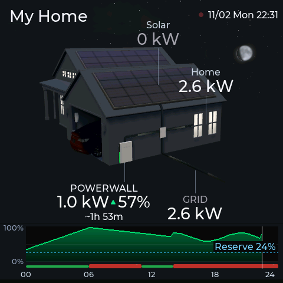
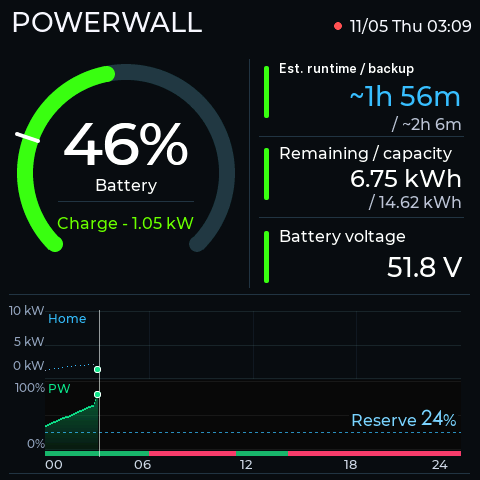
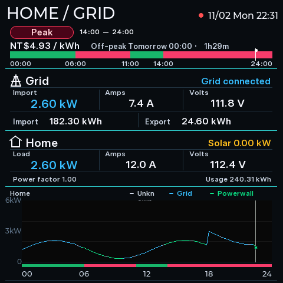
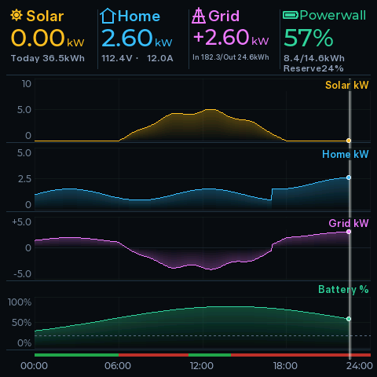
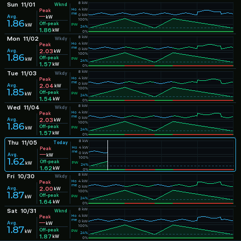
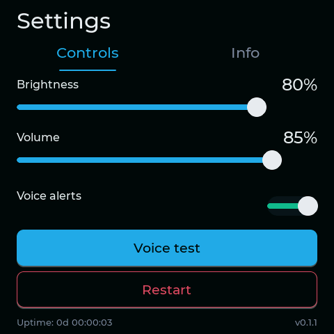
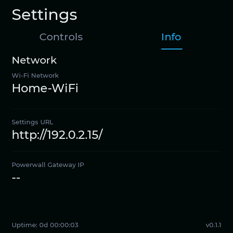

[繁體中文版](README.md)

# Powerwall Dashboard ESP32

Powerwall Gateway dashboard firmware for the Waveshare ESP32-S3-Touch-LCD-4B. See the [Waveshare product page](https://www.waveshare.com/esp32-s3-touch-lcd-4b.htm) for the board.

The v0.1.2 release provides Traditional Chinese and English firmware, spoken alerts, local settings, and on-device history. The Powerwall page adds a home-use trend, and the Week page keeps the Today badge on one line. The repository also includes an LVGL simulator and firmware build/package tools.

## Screenshots

These pages were rendered by this project's simulator with synthetic demo data. They are not device captures and contain no live Gateway data.

### Home



### Powerwall



### Home and grid



### Today's trend



### Seven-day history



### Settings: Controls



### Settings: Info



## Buttons and first-time setup

- The upper button on the right advances through the five dashboard pages, one page per press.
- The lower button on the right opens Settings. Use the on-screen tabs to switch between Controls and Info.
- Controls lets you adjust brightness and volume, enable or disable voice announcements, and play a voice test. Settings are stored in device NVS.
- Gateway IP and password fields start blank on a new device. Firmware loads existing saved values from NVS first.
- On first boot, connect a phone to the `powerwall-dashboard` Wi-Fi network and follow the captive portal prompt. If it does not open automatically, browse to `http://192.168.4.1/`.
- Enter your Wi-Fi name and password, the Gateway IP and password, and your time zone. The default is UTC+08:00; whole-hour offsets from UTC−12:00 through UTC+14:00 are supported and stored in NVS.
- After the device joins Wi-Fi, open Settings → Info and read **Settings URL**. From a phone or computer on the same Wi-Fi, open that address to revisit the settings page.

## v0.1.2 flashing steps

### 1. Get the `main` scripts and firmware ZIP

The full-flash scripts are on the current `main` branch. For a new clone:

```sh
git clone https://github.com/superdhuang/powerwall-dashboard-esp32.git
cd powerwall-dashboard-esp32
```

For an existing clone, update it first:

```sh
git checkout main
git pull origin main
```

Download `powerwall-dashboard-esp32-v0.1.2-firmware.zip` from the [v0.1.2 GitHub Release](https://github.com/superdhuang/powerwall-dashboard-esp32/releases/tag/v0.1.2) and extract it into the repository root:

```sh
curl -fL 'https://github.com/superdhuang/powerwall-dashboard-esp32/releases/download/v0.1.2/powerwall-dashboard-esp32-v0.1.2-firmware.zip' -o /tmp/powerwall-dashboard-esp32-v0.1.2-firmware.zip
unzip -o /tmp/powerwall-dashboard-esp32-v0.1.2-firmware.zip -d .
```

The expected directories are `flash_images/esp32-s3-lcd-4b/releases/v0.1.2/zh/` and `en/`. Each contains a `manifest.json`, `app.bin`, `assets.bin`, and the other images. To build the bundle yourself, follow the build instructions below from the `v0.1.2` tag, then switch back to `main` for the flash scripts.

### 2. Check the manifests and SHA-256

Confirm that both manifests identify release v0.1.2, the matching language, and the Waveshare S3 target; then verify every file checksum from the ZIP:

```sh
python3 - <<'PY'
import json
from pathlib import Path
root = Path('flash_images/esp32-s3-lcd-4b/releases/v0.1.2')
for lang in ('zh', 'en'):
    manifest = json.loads((root / lang / 'manifest.json').read_text())
    assert manifest['release_id'] == 'v0.1.2'
    assert manifest['language'] == lang
    assert manifest['target'] == 'waveshare-esp32s3-touch-lcd-4b'
    print(f'{lang}: manifest OK')
PY
(cd flash_images/esp32-s3-lcd-4b/releases/v0.1.2 && shasum -a 256 -c SHA256SUMS)
```

### 3. Find the device serial port

Connect the board over USB, then run `pio device list` on macOS and choose the port listed for the board under `/dev/cu.*`. If PlatformIO CLI is unavailable, run `ls /dev/cu.*` and identify the newly connected USB serial device. Replace the example below with the port shown on your Mac:

```sh
DEVICE_PORT="/dev/cu.usbmodemYOUR_DEVICE"
```

### 4. Normal update: write app and assets only

Choose one language and run its dry-run first. It validates the bundle and prints the write plan without opening the serial port:

```sh
./write-rel.sh --dry-run --port "$DEVICE_PORT"      # Traditional Chinese
./write-rel-en.sh --dry-run --port "$DEVICE_PORT"   # English
```

After confirming the language and port, run only the selected script without `--dry-run`:

```sh
./write-rel.sh --port "$DEVICE_PORT"      # Traditional Chinese
./write-rel-en.sh --port "$DEVICE_PORT"   # English
```

This is the normal update path: it writes only app/assets and preserves Wi-Fi/Gateway settings, NVS, and recorded history. Logs are saved under `log/write-rel*.log`.

### 5. Full flash: separate option that erases all data

**Use this only when intentionally initializing the device. FULL erases the entire 16 MB flash, including Wi-Fi/Gateway credentials, device settings, NVS, and all recorded history.** For normal updates, use `write-rel*.sh` in the previous step.

Run a dry-run first. It does not open the serial port and requires no confirmation phrase:

```sh
./write-full.sh --dry-run --port "$DEVICE_PORT"      # Traditional Chinese
./write-full-en.sh --dry-run --port "$DEVICE_PORT"   # English
```

After checking the plan, choose one language. Interactive runs prompt you to type `ERASE ALL FLASH`; for a non-interactive run, explicitly pass `--confirm-erase`:

```sh
./write-full.sh --port "$DEVICE_PORT"                         # interactive confirmation
./write-full-en.sh --port "$DEVICE_PORT" --confirm-erase     # explicit confirmation
```

Full-flash logs are saved under `log/write-full*.log`. After the erase, the device starts its `powerwall-dashboard` setup AP again; repeat the Wi-Fi, Gateway, and time-zone setup steps above.

## Build from source

Install PlatformIO Core and Python 3. To build the v0.1.2 package from its original source, check out the release tag and run this from the repository root:

```sh
git checkout v0.1.2
python3 firmware/tools/package_s3_release.py --release-id v0.1.2
```

This builds the zh/en release images under `flash_images/esp32-s3-lcd-4b/releases/v0.1.2/{zh,en}` and records the app/assets hashes and source commit in each manifest. To build only the app images, run these from the repository root:

```sh
pio run -d firmware -e waveshare-esp32s3-touch-lcd-4b-release
pio run -d firmware -e waveshare-esp32s3-touch-lcd-4b-en-release
```

`.gitignore` excludes `flash_images/`; binary release assets are distributed separately from the source repository.

The published v0.1.2 ZIP and its `SHA256SUMS` are the checksum reference for that release. A rebuild is not guaranteed to be byte-for-byte identical because PlatformIO uses the upstream `stable` platform. The existing v0.1.1 tag and release assets remain unchanged.

## Simulator source

The Git source tracks the simulator code, not compiled binaries. The v0.1.2 [GitHub Release](https://github.com/superdhuang/powerwall-dashboard-esp32/releases/tag/v0.1.2) also offers an optional macOS arm64 simulator ZIP for macOS 26 or later. SDL2 is not bundled; install it locally with Homebrew using `brew install sdl2`. Building from source requires an Apple Silicon Mac, Homebrew SDL2, PlatformIO Core, and Python 3. After a fresh clone, install the PlatformIO package dependencies, then build each language:

```sh
pio pkg install -d firmware -e waveshare-esp32s3-touch-lcd-4b
make firmware_sim_native480
make firmware_sim_native480_en
./run-zh.sh --demo
./run-en.sh --demo
```

Running `make` prints these build commands and prerequisites.

The launchers default to synthetic data. Demo mode makes no Gateway requests and does not read local `nvs_config.json` or history files. For LIVE mode, create a local `nvs_config.json` with your own settings (it is ignored by Git) and run the wrapper with `--live`. The private configuration file is not included in the Git repository.

Copy `nvs_config.example.json` to `nvs_config.json`, then fill in your own Gateway address and password. The JSON shape is:

```json
{
  "gateway_ip": "",
  "gateway_password": "",
  "gateway_email": "customer@example.com",
  "site_title": ""
}
```

Launch LIVE using the wrapper's `--live` flag, or pass both Gateway credentials on the command line. Command-line values override the file in memory and are not saved. Supplying only one credential prints an error and exits without echoing a password:

```sh
./run-en.sh --live
./run-en.sh --gateway-ip YOUR_GATEWAY_IP --gateway-password YOUR_GATEWAY_PASSWORD
```

Replace the example values with your own settings. A command-line password may remain in shell history or the process list; use the local `nvs_config.json` when that matters. The private configuration file is ignored by Git and excluded from release archives.
