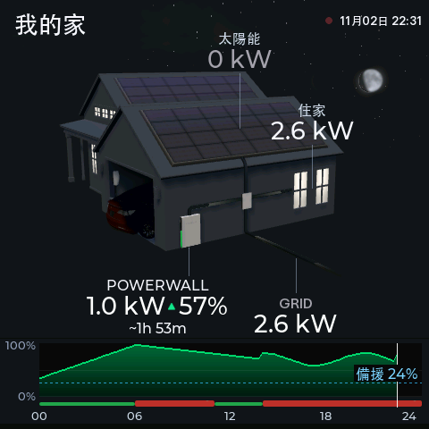
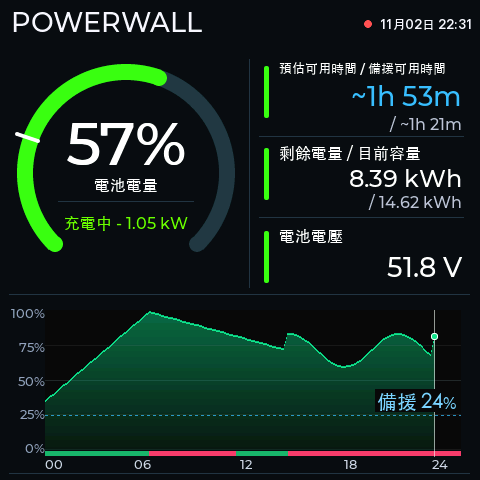
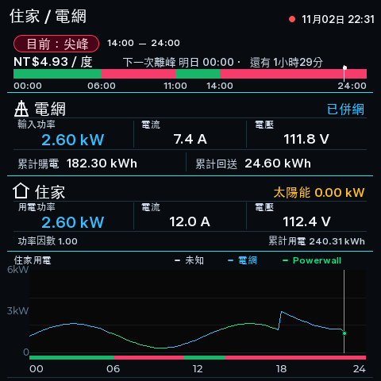
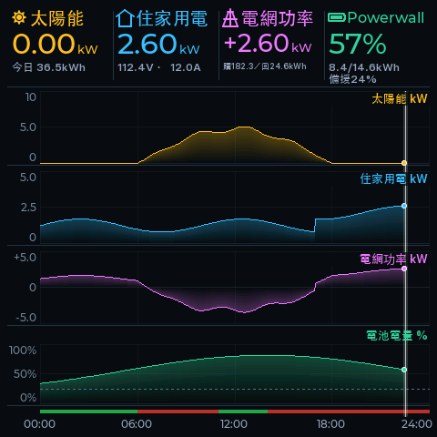
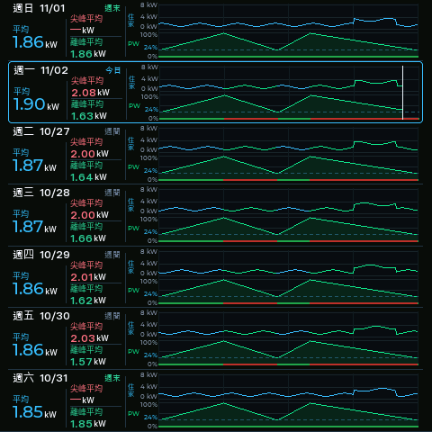
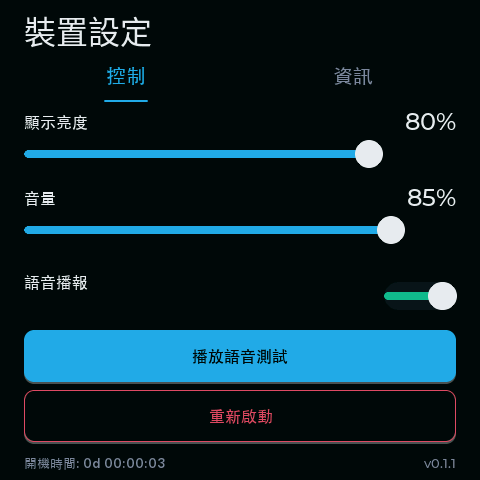
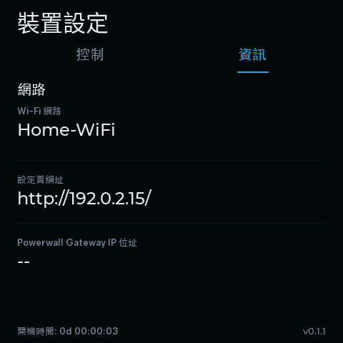

[English version](README.en.md)

# Powerwall Dashboard ESP32

本專案提供 Powerwall Gateway 儀表板韌體，支援 Waveshare ESP32-S3-Touch-LCD-4B。開發板購買頁請見 [Waveshare 官方產品頁](https://www.waveshare.com/esp32-s3-touch-lcd-4b.htm)。

v0.1.1 提供繁體中文與英文介面、語音播報、本機設定與裝置歷史資料；repo 也包含 LVGL simulator 及韌體建置、打包工具。

## 畫面預覽

以下畫面由本專案 simulator 以合成示範資料產生，沒有使用裝置截圖或真實 Gateway 資料。

### 首頁



### Powerwall



### 電網與住家



### 今日趨勢



### 七日歷史



### 設定：控制



### 設定：資訊



## 按鍵與首次設定

- 右側上鍵切換五個儀表板頁面；每按一次前進一頁。
- 右側下鍵開啟設定（Settings）；畫面分頁可切換控制（Controls）與資訊（Info）。
- 控制頁可調亮度、音量、語音播報與播放語音測試；設定保存在裝置 NVS。
- 新裝置的 Gateway IP 與密碼欄位預設空白。若裝置已有儲存設定，韌體會先載入 NVS 值。
- 首次開機時，手機連線至 Wi-Fi `powerwall-dashboard`，並依提示開啟 captive portal；若未自動跳出，前往 `http://192.168.4.1/`。
- 輸入家中 Wi-Fi 名稱與密碼、Gateway IP 與密碼，並選擇時區。時區預設 UTC+08:00，可選 UTC−12:00 至 UTC+14:00，每小時一格；設定會保存在 NVS。
- 連線完成後，在設定（Settings）的資訊（Info）頁查看 Settings URL，並從同一個 Wi-Fi 網路開啟該網址重新設定。

## v0.1.1 燒錄步驟

### 1. 取得 main 腳本與 firmware ZIP

完整燒錄腳本在 `main` 分支，請使用目前 main 原始碼。新 clone：

```sh
git clone https://github.com/superdhuang/powerwall-dashboard-esp32.git
cd powerwall-dashboard-esp32
```

已有 repo 則先更新：

```sh
git checkout main
git pull origin main
```

從 [v0.1.1 GitHub Release](https://github.com/superdhuang/powerwall-dashboard-esp32/releases/tag/v0.1.1) 下載 `powerwall-dashboard-esp32-v0.1.1-firmware.zip`，解壓到 repo 根目錄：

```sh
curl -fL 'https://github.com/superdhuang/powerwall-dashboard-esp32/releases/download/v0.1.1/powerwall-dashboard-esp32-v0.1.1-firmware.zip' -o /tmp/powerwall-dashboard-esp32-v0.1.1-firmware.zip
unzip -o /tmp/powerwall-dashboard-esp32-v0.1.1-firmware.zip -d .
```

預期會有 `flash_images/esp32-s3-lcd-4b/releases/v0.1.1/zh/` 與 `en/`，各自包含 `manifest.json`、`app.bin`、`assets.bin` 等映像。若自行從原始碼建置 bundle，請依下方建置步驟切到 v0.1.1 tag；完成後切回 `main` 取得燒錄腳本。

### 2. 檢查 manifest 與 SHA-256

確認 zh/en manifest 都標示 v0.1.1、正確語言與 Waveshare S3 目標，再檢查 ZIP 內所有檔案雜湊：

```sh
python3 - <<'PY'
import json
from pathlib import Path
root = Path('flash_images/esp32-s3-lcd-4b/releases/v0.1.1')
for lang in ('zh', 'en'):
    manifest = json.loads((root / lang / 'manifest.json').read_text())
    assert manifest['release_id'] == 'v0.1.1'
    assert manifest['language'] == lang
    assert manifest['target'] == 'waveshare-esp32s3-touch-lcd-4b'
    print(f'{lang}: manifest OK')
PY
(cd flash_images/esp32-s3-lcd-4b/releases/v0.1.1 && shasum -a 256 -c SHA256SUMS)
```

### 3. 找出裝置序列埠

用 USB 連接並開啟開發板，在 macOS 執行 `pio device list`，選取該板的 `/dev/cu.*` 序列埠。若沒有 PlatformIO CLI，也可執行 `ls /dev/cu.*`，再辨認新出現的 USB 序列裝置。將下例替換成實際列出的 port：

```sh
DEVICE_PORT="/dev/cu.usbmodemYOUR_DEVICE"
```

### 4. 一般更新：只寫 app 與 assets

選擇一種語言，先 dry-run。它會驗證 bundle 並列出寫入計畫，不會開啟序列埠：

```sh
./write-rel.sh --dry-run --port "$DEVICE_PORT"      # 繁體中文
./write-rel-en.sh --dry-run --port "$DEVICE_PORT"   # English
```

確認使用正確語言與 port 後，只執行其中一支並移除 `--dry-run`：

```sh
./write-rel.sh --port "$DEVICE_PORT"      # 繁體中文
./write-rel-en.sh --port "$DEVICE_PORT"   # English
```

這是一般更新方式：只更新 app/assets，保留 Wi-Fi/Gateway 設定、NVS 與歷史資料。每次執行的 log 在 `log/write-rel*.log`。

### 5. 完整燒錄：另行選擇，會清除所有資料

**只有在要完整初始化裝置時才使用。FULL 會清除整顆 16 MB Flash，包含 Wi-Fi/Gateway 憑證、裝置設定、NVS 與所有歷史資料。** 一般更新請回到上一步使用 `write-rel*.sh`。

先 dry-run；它不開序列埠，也不需要確認短語：

```sh
./write-full.sh --dry-run --port "$DEVICE_PORT"      # 繁體中文
./write-full-en.sh --dry-run --port "$DEVICE_PORT"   # English
```

確認後選擇一個語言執行。互動式執行時，依提示輸入 `ERASE ALL FLASH`；非互動執行可明確加 `--confirm-erase`：

```sh
./write-full.sh --port "$DEVICE_PORT"                         # 互動確認
./write-full-en.sh --port "$DEVICE_PORT" --confirm-erase     # 明確確認
```

Full-flash log 在 `log/write-full*.log`。清除後首次開機會重新進入 `powerwall-dashboard` 設定 AP；請依上方「按鍵與首次設定」重新設定 Wi-Fi、Gateway 與時區。

## 從原始碼建置

需要 PlatformIO Core 與 Python 3。要重現 v0.1.1 韌體套件，先切到 release tag，再從 repo 根目錄執行：

```sh
git checkout v0.1.1
python3 firmware/tools/package_s3_release.py --release-id v0.1.1
```

此命令會建置 zh/en release image，產生 `flash_images/esp32-s3-lcd-4b/releases/v0.1.1/{zh,en}`，並在 manifest 記錄 app/assets 雜湊與來源 commit。若只要編譯 app image，可在 repo 根目錄分別執行：

```sh
pio run -d firmware -e waveshare-esp32s3-touch-lcd-4b-release
pio run -d firmware -e waveshare-esp32s3-touch-lcd-4b-en-release
```

`flash_images/` 由 `.gitignore` 排除；binary release ZIP 與 source repo 分開保存。

## Simulator（原始碼）

Git 原始碼只追蹤 simulator 原始碼，不包含編譯後的執行檔。v0.1.1 [GitHub Release](https://github.com/superdhuang/powerwall-dashboard-esp32/releases/tag/v0.1.1) 另提供可選的 macOS arm64 simulator ZIP；適用 macOS 26 以上，ZIP 不含 SDL2，請先用 Homebrew 安裝 `brew install sdl2`。從原始碼建置需 Apple Silicon Mac、Homebrew SDL2、PlatformIO Core 與 Python 3。首次 clone 後先安裝 PlatformIO 套件，再分別建置繁中與英文版：

```sh
pio pkg install -d firmware -e waveshare-esp32s3-touch-lcd-4b
make firmware_sim_native480
make firmware_sim_native480_en
./run-zh.sh --demo
./run-en.sh --demo
```

launcher 預設使用合成資料；demo 不連線 Gateway，也不讀取本機的 `nvs_config.json` 或歷史資料。要用本機設定進入 LIVE，先複製範本並填入自己的 Gateway IP 與密碼：

```sh
cp nvs_config.example.json nvs_config.json
./run-zh.sh --live
```

`nvs_config.json` 的格式如下；原始碼 repo 會忽略此檔，發佈套件不包含此檔：

```json
{
  "gateway_ip": "",
  "gateway_password": "",
  "gateway_email": "customer@example.com",
  "site_title": ""
}
```

也可以同時傳入 `--gateway-ip` 與 `--gateway-password`；兩者一起使用會直接進入 LIVE，並在記憶體中覆蓋檔案的 Gateway 欄位，不會寫回檔案。只提供其中一個會顯示錯誤並結束，程式不會回顯密碼：

```sh
./run-zh.sh --gateway-ip YOUR_GATEWAY_IP --gateway-password YOUR_GATEWAY_PASSWORD
```

請把示意值換成自己的設定。命令列密碼可能留在 shell history 或 process list；需要時改用本機 `nvs_config.json`。
